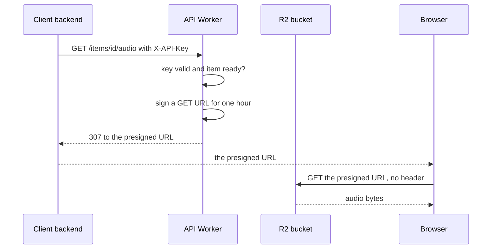

# Authentication

## 🔭 Overview

Items are private: an article someone enqueues is theirs, not public. A single API key is the user's identity, and it guards every route that touches an item.

## ⚙️ Implementation details

The API Worker checks the key once, in front of every route under `/items`, so no handler checks it individually; a missing or wrong key answers `401`. The key is a secret only the API Worker holds.

Possessing the key **is** being the user: there is no separate identity, session, or login. The key is presented on an `X-API-Key` header and checked against the single configured value on every item route: creation, polling, retry, audio and images alike. `/health` is the one public route, and it carries no item data, a deliberate, narrow exception for platform health checks (see [deployment-and-ci](deployment-and-ci.md)).

> [!NOTE] Why one key rather than sessions or OAuth, for now
> The first consumer is an agent (Tachikoma), not a browser: it wants to present one credential on each call, not run an interactive login. There is no audience yet to onboard with real accounts; multi-user identity comes later, once anyone besides the owner wants this, and the private queue works for its first user without it.

## 📩 How audio reaches a browser without the key

The audio and image routes require the key to **obtain** a link, and the audio route mints one only for a `ready` item. Each answers with a `307` to a GET URL for the object in the R2 bucket, signed by the API Worker with its own R2 API token for one hour, in every environment (see [persistence-and-storage](persistence-and-storage.md)). The URL itself carries the signature, so the request that follows it needs no header at all. The bucket stays private: every way to read it is a link minted to an authenticated caller, and those links expire.

Only a backend holds the API key. A web app's own backend calls the route, takes the presigned URL from the `307`, and hands that URL to the browser. The audio route accepts no key in the query string, so the key never reaches a page.

> [!NOTE] Why the route mints a link instead of gating the bytes
> A browser `<audio>` element cannot attach a custom header to the request it makes for the audio file, so the key alone cannot gate the byte stream. Gating the link that leads to the bytes is the check a browser can pass.

## ⏩ What is not built yet

**Multi-user is a rewrite of the guard.** Going multi-user means introducing genuine identity and per-user key management, with a Google OAuth login taking the place of the single-key shim rather than sitting beside it. See [the queue](../product-design/queue.md) for what a user sees once multiple keys and key management exist.

---

Related: [item-lifecycle](item-lifecycle.md) · [item-contract](item-contract.md) · [persistence-and-storage](persistence-and-storage.md) · [deployment-and-ci](deployment-and-ci.md) · [invariants](invariants.md)
