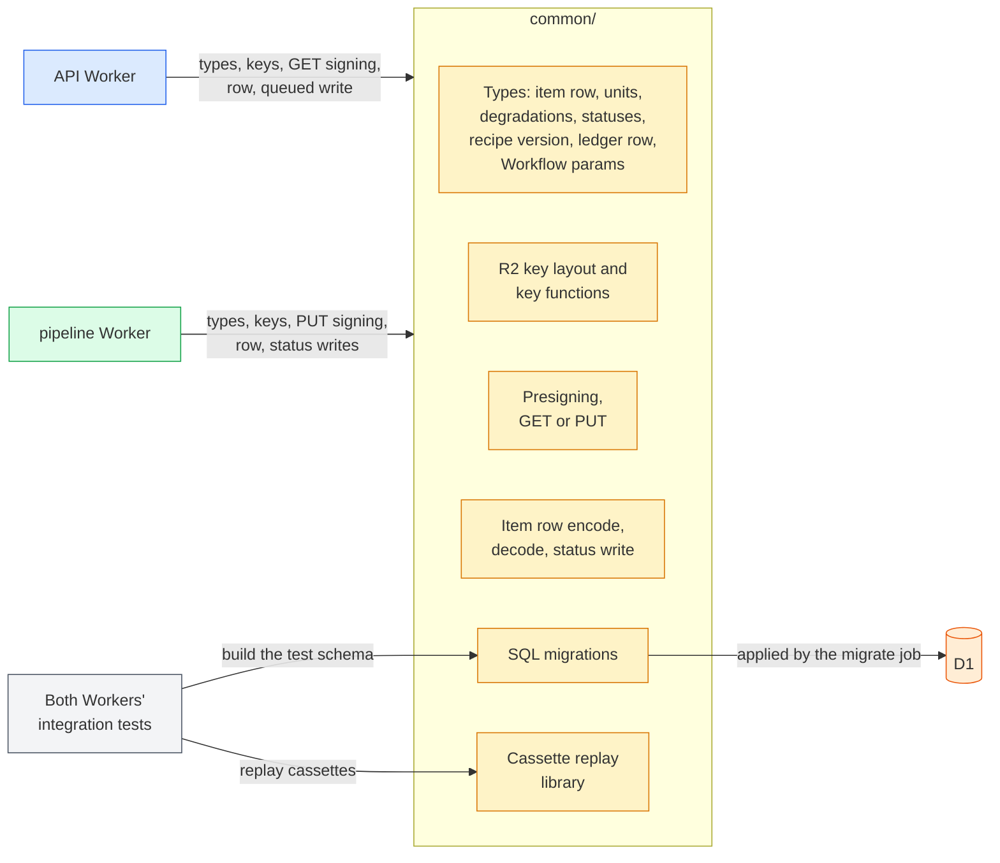

# The common/ package

## 🔭 Overview

common/ is the TypeScript package that api/ and pipeline/ both build from, and it holds everything both Workers use: the shared types, the R2 key layout, presigning, item row reads and writes, the hand-written SQL migrations for D1 and the cassette replay library the integration tests use. Code that only the pipeline's own modules share stays in pipeline/. Of its contents only the migrations are deployed, by the Cloudflare CI workflow's migrate job; the rest is compiled into each Worker. The shared types are checked when the code builds, never at runtime.

## 🏗️ Architecture

The API Worker and the pipeline Worker import common/ at build time. The Cloudflare CI workflow's migrate job applies the SQL migrations to D1, and both Workers' tests apply the same migrations to build their own D1 schema. The replay library runs only inside both Workers' integration tests.

## 📦 What it holds

Each piece is described in the note of the part that uses it.

| Piece | Holds | Used by | Described in |
|---|---|---|---|
| Item row type | the item row with its statuses, units, degradations and error | the API Worker, the item Workflow | [persistence-and-storage](persistence-and-storage.md), [item-contract](item-contract.md) |
| Unit union | the typed unit each item's display, spoken form and timing ride on | the API Worker, the item Workflow | [item-contract](item-contract.md) |
| Recipe version row type | one version of a domain's recipe | the item Workflow, the recipe runtime | [persistence-and-storage](persistence-and-storage.md) |
| Ledger row type | the ledger row with its event types and units | the item Workflow | [persistence-and-storage](persistence-and-storage.md) |
| Workflow params type | the item id the API Worker creates and restarts the item Workflow with | the API Worker, the item Workflow | [item-lifecycle](item-lifecycle.md) |
| R2 key layout | the bucket's audio/ and images/ prefixes, and the functions that build an audio key from an item id and an image key from a content hash | the API Worker, the item Workflow | [persistence-and-storage](persistence-and-storage.md) |
| Presigning | one function that signs a GET or a PUT URL for a key with a given R2 token and lifetime | the API Worker for GET, the pipeline Worker for PUT | [persistence-and-storage](persistence-and-storage.md) |
| Item row reads and writes | encoding and decoding the JSON columns, and the status write that sets a status and stamps updated_at, clearing the error for queued and generating and requiring one for failed | the API Worker for queued and for a failed enqueue, the step wrapper for every status after enqueue, including `failed` after a step's last attempt | [item-lifecycle](item-lifecycle.md) |
| SQL migrations | the D1 schema, as hand-written SQL files | the Cloudflare CI workflow's migrate job, both Workers' tests, local development | [deployment-and-ci](deployment-and-ci.md), [local-development](local-development.md) |
| Cassette replay library | our TypeScript copy of vcrpy, replay only | both Workers' integration tests | this note |

## 📼 Replaying cassettes in tests

The replay library reads the repository's vcrpy cassettes and answers each outgoing request from them. It matches a request on its method, scheme, host, port and query, and on its path and body with every item id normalized. Before matching, it removes the credential headers (authorization, x-api-key and x-goog-api-key), which the cassettes were recorded without. It records nothing. A request that matches no recorded response fails the test.

## 🔒 Checking the shared types at build time

The shared types are checked when the code builds and deploys, never at runtime. A value read back from D1 or received from Modal is trusted to match its type, and nothing parses it against a schema.

A change to common/ runs the type checks of api/ and pipeline/ against it in CI. When either check fails, the whole deploy stops: the migrate job applies no migration, and neither Worker deploys. When both pass, the migrate job applies the migrations to D1 with wrangler, then the pipeline Worker deploys and then the API Worker, all in one CI workflow. [deployment-and-ci](deployment-and-ci.md) holds that order.

> [!NOTE] Why the types are not validated at runtime
> Both Workers are type-checked against the same common/ before anything deploys, so a shape the two Workers disagree on stops the deploy before it reaches production. This departs from the code style's rule that a payload crossing a service boundary validates at runtime.

---

Related: [persistence-and-storage](persistence-and-storage.md) · [item-contract](item-contract.md) · [item-lifecycle](item-lifecycle.md) · [deployment-and-ci](deployment-and-ci.md) · [local-development](local-development.md)
