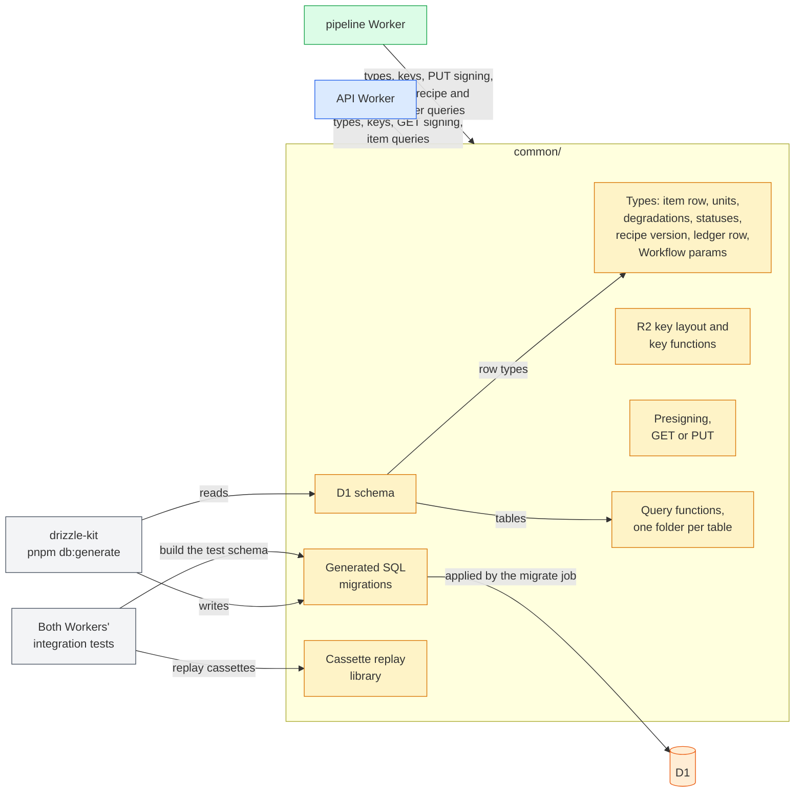
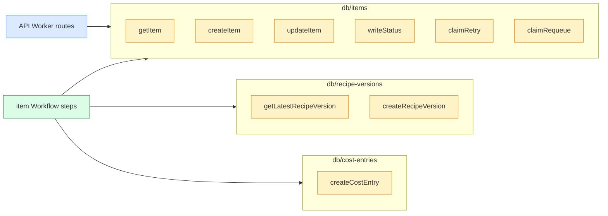

# The common/ package

## 🔭 Overview

common/ is the TypeScript package that api/ and pipeline/ both build from, and it holds everything both Workers use: the shared types, the R2 key layout, presigning, the drizzle schema of the D1 database with one query function for every read and write, the SQL migrations drizzle-kit generates from that schema, and the cassette replay library the integration tests use. Code that only the pipeline's own modules share stays in pipeline/, except database code: every D1 query lives here even when one Worker alone calls it, so no route or step writes SQL. The Cloudflare CI workflow's migrate job deploys the migrations, and nothing else in the package deploys: each Worker's build compiles the rest from source, with no build step of common/'s own. The TypeScript compiler checks the shared types when each Worker builds; nothing checks them at runtime.

## 🏗️ Architecture

The API Worker and the pipeline Worker import common/ at build time. The schema is the one source of the row types, the query functions' tables and the migrations: drizzle-kit reads it and writes each migration, and the developer reviews and commits that migration. The Cloudflare CI workflow's migrate job applies the SQL migrations to D1, and both Workers' tests apply the same migrations to build their own D1 schema. The replay library runs only inside both Workers' integration tests.

## 📦 What it holds

Each piece is described in the note of the part that uses it.

| Piece | Holds | Used by | Described in |
|---|---|---|---|
| Item row type | the item row with its statuses, units, degradations and error, derived from the schema's `items` table | the API Worker, the item Workflow | [persistence-and-storage](persistence-and-storage.md), [item-contract](item-contract.md) |
| Unit union | the typed unit each item's display, spoken form and timing ride on | the API Worker, the item Workflow | [item-contract](item-contract.md) |
| Recipe version row type | one version of a domain's recipe, derived from the schema's `recipe_versions` table | the item Workflow, the recipe runtime | [persistence-and-storage](persistence-and-storage.md) |
| Ledger row type | the ledger row with its event types and units, derived from the schema's `cost_entries` table | the item Workflow | [persistence-and-storage](persistence-and-storage.md) |
| Workflow params type | the item id the API Worker creates and restarts the item Workflow with | the API Worker, the item Workflow | [item-lifecycle](item-lifecycle.md) |
| R2 key layout | the bucket's audio/ and images/ prefixes, and the functions that build an audio key from an item id and an image key from a content hash | the API Worker, the item Workflow | [persistence-and-storage](persistence-and-storage.md) |
| Presigning | one function that signs a GET or a PUT URL for a key with a given R2 token and lifetime | the API Worker for GET, the pipeline Worker for PUT | [persistence-and-storage](persistence-and-storage.md) |
| D1 schema | the three tables with every column, CHECK, foreign key and index, as drizzle table definitions | the query functions, the row types, drizzle-kit | this note, [persistence-and-storage](persistence-and-storage.md) |
| Query functions | one function per read or write of D1, in one folder per table | both Workers' routes and steps | this note |
| SQL migrations | the D1 schema as SQL, generated by drizzle-kit from the schema and committed | the Cloudflare CI workflow's migrate job, both Workers' tests, local development | [deployment-and-ci](deployment-and-ci.md), [local-development](local-development.md) |
| Cassette replay library | our TypeScript copy of vcrpy, replay only | both Workers' integration tests | this note |

## 🗄️ Reading and writing D1

`database(d1)` wraps a D1 binding in a drizzle client built with the schema. Every route and every item Workflow step builds the client once from its env and passes it to the query functions; nothing else touches the binding. Each table has a folder under `src/db/`, and its functions follow one naming pattern: `get<Model>`, `list<Models>`, `create<Model>`, `update<Model>` and `delete<Model>`, plus a conditional write named for what it does when a plain update cannot express it. A function exists only once a caller needs it, so no table has a `list` or a `delete` yet.

> [!NOTE] Why database code lives in common/ even when one Worker calls it
> With every query beside the schema, a developer edits a column and every query that touches it in one package, one type check covers both, and a reader finds all of D1's reads and writes in one tree.

| Function | Answers | Called by |
|---|---|---|
| `getItem` | the item row, or null for an unknown id | every route that reads an item |
| `createItem` | the insert of a `queued` item; it mints the `itm_` id and the timestamps and returns the id with the query | enqueue |
| `updateItem` | an update of the given columns by id, stamping `updated_at` | the fetch, recipe, images, describe and store steps |
| `writeStatus` | the status write in the two forms [item-lifecycle](item-lifecycle.md) describes, built on `updateItem` | the step wrapper for every status after enqueue except `ready`, the API for `failed` when it cannot create or restart the instance |
| `claimRetry` | whether this call claimed the retry: one update to `queued` that sets `retry_count` to the read count plus one, where the item is still `failed`, still at the count read and under the cap; claimed when the update returns a row | the retry route |
| `claimRequeue` | whether this call claimed the re-queue: one update that moves `queued_at`, where the item is still `queued` and still stale | the poll, through its re-queue check |
| `getLatestRecipeVersion` | the domain's highest recipe version, or null | the recipe step |
| `createRecipeVersion` | reads the domain's latest version and inserts the next one, minting the `rcp_` id | the recipe step, when an agent settles a script |
| `createCostEntry` | the insert of one ledger row, minting the `cst_` id | the fetch, describe and store steps |

The schema keeps the column keys in snake_case, so the row types derived from it carry the column names as their fields. The status, cost type and cost unit columns take their values from the `ITEM_STATUS`, `COST_TYPE` and `COST_UNIT` constant maps and carry an explicit CHECK, because drizzle's enum option types a column without emitting one. `units`, `degradations` and `detail` are JSON columns that drizzle encodes on write and decodes on read, each typed with its common/ type; `cached` reads back a boolean.

A function returns the drizzle query unawaited, except `createRecipeVersion` and the two claims, which read before they write or return whether the write matched a row. A caller awaits a query alone, or hands several to `db.batch([...])`, which D1 runs as one transaction: the fetch step writes the item and its Firecrawl ledger row in one batch, the describe step the item and its describer rows, and the store step the finished item and its TTS row.

> [!TIP] Rejected: an interactive transaction
> D1 rejects `BEGIN` from a Worker binding, so a Worker cannot open a transaction that reads, decides in code and writes. A batch is the one atomic unit D1 offers. Every write that has to be atomic with a read is a single conditional statement instead: the claims gate on the state they read, and `UNIQUE(domain, version)` makes the second of two concurrent `createRecipeVersion` calls at the same number fail.

## 📼 Replaying cassettes in tests

The replay library reads the repository's vcrpy cassettes and answers each outgoing request from them. It matches a request on its method, scheme, host, port and query, and on its path and body with every item id normalized. Headers take no part in the match, so a request carrying credentials matches a cassette recorded without them. It records nothing. A request that matches no recorded response fails the test.

## 🔒 Checking the shared types at build time

The shared types are checked when the code builds and deploys, never at runtime. A value read back from D1 or received from Modal is trusted to match its type, and nothing parses it against a schema.

A change to common/ runs the type checks of api/ and pipeline/ against it in CI. When either check fails, the whole deploy stops: the migrate job applies no migration, and neither Worker deploys. When both pass, the migrate job applies the migrations to D1 with wrangler, then the pipeline Worker deploys and then the API Worker, all in one CI workflow. [deployment-and-ci](deployment-and-ci.md) holds that order.

> [!NOTE] Why the types are not validated at runtime
> Both Workers are type-checked against the same common/ before anything deploys, so a shape the two Workers disagree on stops the deploy before it reaches production. CLAUDE.md's code style states the same rule: the Workers' types are checked when the code builds, never at runtime.

---

Related: [persistence-and-storage](persistence-and-storage.md) · [item-contract](item-contract.md) · [item-lifecycle](item-lifecycle.md) · [deployment-and-ci](deployment-and-ci.md) · [local-development](local-development.md)
