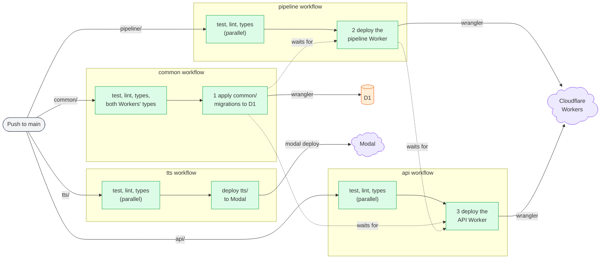

# Deployment and CI

## 🔭 Overview

Nagara ships as three deployables: the API Worker and the pipeline Worker on Cloudflare, and the TTS service on Modal. Each tree runs its own CI checks, path-filtered to its directory. The two Workers deploy with wrangler in a fixed order, after `common/`'s migrations are applied to D1; `tts/` deploys to Modal on its own.

## ☁️ How the Workers deploy

Both Workers deploy with wrangler. Their configurations bind the same D1 database and the same R2 bucket, and the API Worker's configuration binds the item Workflow by the pipeline Worker's script name. `nagara.asermax.com` points at the API Worker, the only Worker clients reach.

> [!NOTE] Why the pipeline Worker has no public routes
> The API Worker creates and restarts the item Workflow through the cross-script Workflow binding, and nothing else calls the pipeline. With no route to reach, the pipeline Worker carries no authentication of its own and no edge policy guards it.

`api/` deploys with wrangler from its own configuration, from within `api/` or via CI below; see [item-contract](item-contract.md) for the routes it serves.

`pipeline/` deploys with `pnpm deploy`, from within `pipeline/` or via CI below; see [item-lifecycle](item-lifecycle.md) for what runs on it. That script builds before it ships: `pnpm build` runs Vite with the Flue and Cloudflare plugins, writing the bundled Worker and a generated `wrangler.json` into `dist/nagara/`, and `wrangler deploy -c dist/nagara/wrangler.json` ships that generated config rather than the hand-written `pipeline/wrangler.jsonc`. The Flue plugin adds the author and revision agents' Durable Object bindings at build time, so the source config alone would ship a Worker without them.

`common/` deploys nothing but its SQL migrations, which its own CI workflow applies to D1 with wrangler; see [common-package](common-package.md) for the rest of the package.

> [!NOTE] Why migrations, then the pipeline, then the API
> Both Workers read and write D1, so the schema they build against is applied before either deploys. The API Worker's Workflow binding fails with `workflow.not_found` until the pipeline Worker that holds the item Workflow is deployed, so the pipeline always goes before the API.

## 🔐 Which secrets each Worker holds

Each Worker holds only the secrets its own calls need.

| Worker | Holds |
|---|---|
| API Worker | the API key, and an R2 API token it signs GET URLs with |
| pipeline Worker | the Firecrawl and Gemini keys, the AI Gateway token, Modal's proxy auth token, and an R2 API token it signs PUT URLs with |

## 🎙️ How the TTS service deploys

`tts/` is pushed independently with `modal deploy`, from within `tts/` or via CI below; see [tts-service](tts-service.md) for what actually runs on Modal.

## 🔁 CI: one path-filtered workflow per tree, deploys in a fixed order

Each tree runs **test, lint and types as three parallel jobs** on pushes to `main`, path-filtered to its own directory (`api/**`, `pipeline/**`, `common/**`, `tts/**`), so a docs-only push, or a change to one tree, runs neither another tree's checks nor its deploy. A change to `common/` also runs the type checks of `api/` and `pipeline/` against the changed package, inside `common/`'s workflow. The `api`, `pipeline` and `common` jobs install with `pnpm install --frozen-lockfile` on Node 24 and run `pnpm test`, `pnpm lint` and `pnpm types`; the `tts` jobs provision the pinned toolchain (uv/ruff/ty/pytest, see the repository's `CLAUDE.md`) with `uv sync --frozen` against `tts/`'s lockfile.

Three workflows ship the Cloudflare side with `cloudflare/wrangler-action`, each after its own checks pass: `common/`'s workflow applies its SQL migrations to D1, the pipeline's workflow runs `pnpm build` and deploys `dist/nagara/wrangler.json`, and the API's workflow deploys the API Worker. The pipeline and API workflows wait for `common/`'s workflow to succeed before they deploy, and the API deploys after the pipeline. When a check in `common/`'s workflow fails, nothing deploys: no migration, no pipeline deploy and no API deploy. The three authenticate with `CLOUDFLARE_API_TOKEN` and `CLOUDFLARE_ACCOUNT_ID`. `tts` adds a **`deploy` job that depends on all three of its checks**, runs `modal deploy` and authenticates with `MODAL_TOKEN_ID` / `MODAL_TOKEN_SECRET`. All four are GitHub Actions secrets.

> [!WARNING] Two migration runs at once are not guarded
> Nothing serializes two runs of `common/`'s workflow, so two pushes to `main` in quick succession can apply `common/`'s migrations twice at the same time. The chain relies on deploys never being made twice in quick succession.

The `tts` check jobs install the full dev dependency group (torch-cpu, kokoro, numpy) because `ty` needs them to resolve `app.py`'s image-runtime imports locally; the deploy job installs only the Modal client (`--no-dev`). uv's lockfile-keyed cache absorbs most of the repeat install cost.

## 📦 What binaries the repository accepts

Audio and images are handled differently.

**Audio is ignored outright.** `.gitignore` covers `*.ogg`, `*.wav`, `*.mp3`, `*.m4a`, `*.opus` and `*.flac`, so no audio file can be staged by accident. Every audio file here is output of the TTS pipeline: regenerable for roughly $0.008 an article (see [tts-service](tts-service.md)) and megabytes each, so there is no audio artifact worth the space, and LFS would only make an unwanted commit cheaper rather than preventing it. A test that needs audio generates it into a working directory the ignore already covers.

**Images go through Git LFS.** `.gitattributes` routes `*.png`, `*.jpg`, `*.jpeg` and `*.webp` as LFS pointers, because `web/` will carry real assets that have to be checked in, and a pointer keeps the bytes out of the packfile every clone downloads.

> [!WARNING] A binary committed as a plain blob is permanent until someone rewrites history
> Deleting the file in a later commit removes it from the working tree and leaves the blob in every clone at full size. Two Opus fixtures, 9.35 MB together, reached pushed history this way, and getting them back out took a `filter-repo` rewrite and a force push over a shared branch: `.git` dropped from 12 MB to 672 KB, but the remote still serves each unreachable blob by hash afterwards, because rewriting history does not reach objects already distributed to other clones and caches.

## ⏩ What is not built yet

`web/` and `api/` are served from separate hosts today; serving them from one origin once `web/` exists is not built.

A Worker deploy that lands while item Workflow instances are running is not handled; a deploy can run a step again, and the item Workflow accepts that for synthesis (see [item-lifecycle](item-lifecycle.md)).

---

Related: [tts-service](tts-service.md) · [item-lifecycle](item-lifecycle.md) · [common-package](common-package.md) · [local-development](local-development.md) · [persistence-and-storage](persistence-and-storage.md) · [authentication](authentication.md) · [invariants](invariants.md)
