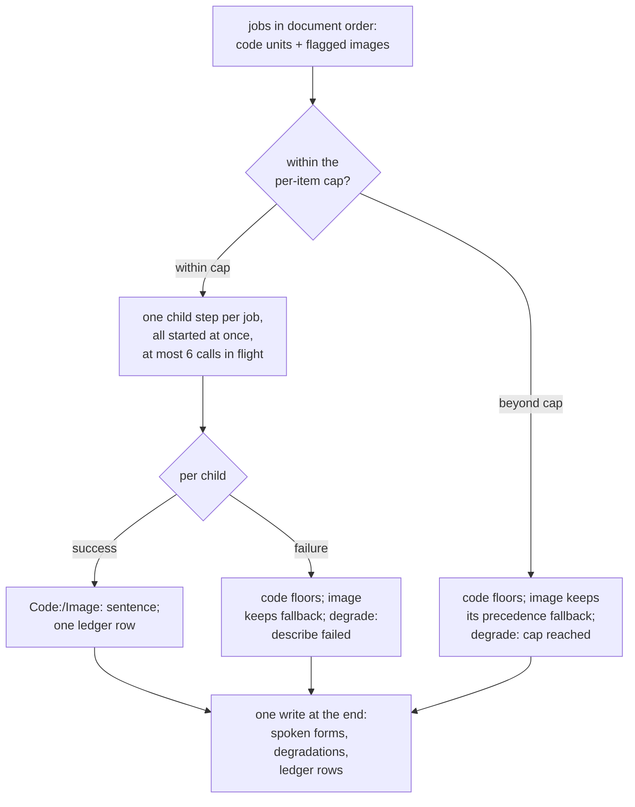

# Image and code describer

## 🔭 Overview

Gives a listener one spoken sentence for a block they cannot see: a code block, or an image with no author-written text. It is a reusable core with two callers: the code path and the image path both reach the same Gemini call, layered under a fan-out that floors, caps, and fails per unit. It never speaks what a block *means*, only what it *is* or *shows*: meaning comes from the author, and the describer only makes the block visible. It runs as the item Workflow's describe step, which starts one child step per description (see [item-lifecycle](item-lifecycle.md)), and every call goes through AI Gateway with the gateway's response cache on.

> [!NOTE] The describer is unchanged by the recipes architecture
> Recipes stop at units ([recipes](recipes.md)); describing code and images stays this generic path, whatever extracted them.

## ♠️ What it exposes

| Member | Answers |
|---|---|
| the core call | one structured-output call plus the sanitize tail, returning the spoken sentence. The caller owns the contents: a prompt string, or a prompt plus the image as an inline part |
| the code prompt | kind and what-for, no opener, the introducing unit as authority |
| the image prompt | one specific sentence of what is shown, alt passed as unreliable context |
| an image describe request | one image the precedence flagged for a describe (case 2): its index in the unit list, its raw alt, and the stored image, a WebP raster or the SVG's markup |
| the fan-out | describe every code unit and every flagged image against one shared budget, in document order, returning the updated units and a degradation list |

## 📞 The core call: structured output, then sanitize

The core call makes one call to `gemini-3.5-flash-lite` through AI Gateway, parses the JSON, and runs the value through the shared sanitize tail. The response schema is a JSON object with one required string field, `spoken`.

The response is requested as `application/json` against that schema, so the model returns `{"spoken": "..."}` and there is nothing to parse out of prose. The parsed `spoken` then passes through the sanitize tail article prose runs through, including the rule that replaces a marker only where it touches text and the rule that speaks a comparison operator as a word (see [article-extraction](article-extraction.md)).

A raster goes to the model as the stored WebP image. An SVG goes as its markup, an inline part with the `text/plain` type, whatever its size.

> [!NOTE] Why an SVG is described from its markup
> The model reads text the markup carries, such as a formula's LaTeX in a `<title>` element, so it names an equation that a rasterised copy only lets it read out symbol by symbol. Every SVG tried this way came back with a usable description. The markup's token count grows with its size, from under a thousand tokens for a small badge to about 28 thousand for a 63 KB chart, and no cap bounds it.

> [!NOTE] Both guards, because a leaked marker is stochastic and only ever caught by ear
> Structured output makes one whole failure class impossible: the model cannot open with a heading or a preamble when the value is a bare string field. But a JSON schema cannot forbid a backtick or a `**` *inside* that string, and a marker reached narration exactly once in the bake-off and did not reproduce across 48 re-runs. "It did not happen this time" is the judgement a pipeline cannot rely on, so sanitize catches the marker the schema cannot.

> [!NOTE] The schema is not repeated in the prompt
> Gemini's own docs warn that duplicating the schema, or JSON examples, in the prompt lowers output quality. The config carries the shape; the prompt describes only the task.

### 🗄️ The gateway's response cache

AI Gateway answers an identical request from its response cache without calling Gemini, and reports the hit in the `cf-aig-cache-status` response header. A describe repeated with the same prompt and the same image, such as a code snippet two articles share, costs no model call. Each successful describe writes one ledger row at the flat describe price, whether Gemini or the cache answered, and sets the row's cached flag when the header reports a hit (see [persistence-and-storage](persistence-and-storage.md)).

## ✍️ The prompts: no opener, an invention guard, minimal asymmetric context

Both prompts share three rules and differ only in subject.

**No self-opener.** The sentence must begin with the thing itself, the kind-noun for code or the visible subject for an image, and the word "This" is forbidden anywhere in it. `Code: ` and `Image: ` are nagara's announcement, so the model owns only the content. An image noun-opens naturally; code needs the ban spelled out, because forbidding "This block" and "This example" alone leaves a residual "This is a…".

**The invention guard** is a sharpened positive instruction with no few-shot. Code: name the kind and the purpose, never the mechanics, return values, or framework, unless the introducing text states them. Image: describe only what is visibly there, and **name no person, organization, brand, place, or region unless that exact name appears as written text inside the image**. The one confirmed invention in the bake-off was geography read onto an artwork, and no run under this guard reproduced it.

**Context is minimal and asymmetric.** The code prompt gets the article title, the introducing paragraph (the unit just before, which the listener heard seconds ago as authority), and the block. The paragraph *after* is dropped. The image prompt gets the title and the alt, labelled as often wrong or SEO filler, to use only where it matches the pixels.

> [!NOTE] Why the paragraph after the block is dropped
> It is the elaboration the listener is about to hear anyway, and including it nudges the model toward describing behaviour rather than naming what the block is.

> [!NOTE] Why one sentence per code block, even when the prose already named it
> Every code block gets its own spoken sentence because it needs its own audio window in the read-along, and dropping it would remove the code from a reader's view. The redundancy with the introducing prose is the price of that window. What the sentence adds above restatement is the *kind*: "the syntax for creating a variable" names the concept; the specific field names and query values that would add most are exactly what the guard forbids as invention.

## 🗣️ What each unit says

A **code** unit's spoken form becomes `Code: <sentence>`, overwriting the interim `"Code sample."` placeholder from the spoken-form derivation.

An **image** follows a four-step precedence, top to bottom. Cases 1, 3, and 4 are the fallback already on the unit from acquisition (see [article-extraction](article-extraction.md)); the describer owns case 2 and the filter that routes between 1 and 2.

| # | Condition | Spoken form |
|---|---|---|
| 1 | good alt | the alt, verbatim |
| 2 | no good alt | **one generated sentence of what the image shows** |
| 3 | generation failed, alt non-empty | any alt, verbatim |
| 4 | generation failed, alt empty | `Image with no description.` |

The **good-alt filter** decides case 1 against case 2. Alt is trusted verbatim only when it reads as a grammatical sentence, is not the article title (the cruft test in [article-extraction](article-extraction.md)), and clears a small CMS denylist (`subscribe`, `appears in`, `courtesy`, `photograph by`, `click`) and filename patterns. Everything else goes to the describer: empty, keyword soup, title-as-alt, a subscribe prompt.

> [!NOTE] The denylist separates good alt from boilerplate where no clean heuristic exists
> "Image of tank rolling over a world map" and "This article appears in the October 2023 issue. Subscribe to WIRED." are *both* grammatical sentences, so grammaticality alone cannot separate good alt from boilerplate. The denylist keeps the first and sends the second to the describer, at the cost of a maintained list a novel boilerplate phrase can slip past.

> [!NOTE] A describe failure never goes silent
> On failure or over-budget, an image keeps its precedence fallback (any non-empty alt, else the floor), so invariant 2's drop-from-both never fires for a *description* failure. It fires one layer earlier, for an *acquisition* failure, which belongs to [article-extraction](article-extraction.md). The floor is honest: it tells the listener an image is there that could not be described.

## 🔀 The fan-out, and its bounds

The fan-out walks the interleaved unit list once into one document-ordered job list of every code unit and every flagged image. That single ordered list is what makes the cap a shared budget across both kinds.

**One shared budget, counted in document order.** The per-item cap (default 25) caps the combined code-and-image total, so the two kinds can never each spend a full budget. Past the cap a code unit floors and an image keeps its precedence fallback; each records a `describe cap reached` degradation. The cap never fails an item and never goes silent.

**One child step per description.** The describe step runs inside the wrapper like every other step, so it writes `current_step` and the status as it starts. Inside it, one child step per job within the cap starts at once, and the describe step awaits them together with `Promise.allSettled`. Each child calls Gemini and returns its result without writing to the item row. The describe step collects the results and writes every unit's spoken form, the degradations and the ledger rows in one write at its end. A fifty-unit article where one call fails keeps the other forty-nine, and the describe step never fails because a child failed.

A Workers instance holds 6 outbound connections at a time, across all its steps, so at most 6 Gemini calls are in flight and the rest wait for a free connection.

> [!NOTE] Why the children return results and one write lands at the end
> The children run concurrently, and a child that wrote its own unit into the row would race its siblings on the same units column. Returning results to the describe step leaves it as the only writer, so the row changes once, with every unit's spoken form, degradation and ledger row together.

> [!WARNING] Waiting for a connection counts toward a step's timeout
> All the child steps start together, but their calls run 6 at a time, and the time a child waits for a free connection counts toward its 1-minute timeout. In the spike that measured it, the last of 25 five-second calls finished 26 s after the fan-out started. A slow gateway or a full budget of large SVGs can push the last children in the queue past their timeout, and each such child fails that attempt.

**Retry policy.** The describe step has 3 attempts of 5 minutes each, and each child step has 3 attempts of 1 minute each. A retry of the describe step runs every child again as new steps, so a repeated describe goes back to AI Gateway, whose response cache answers a request identical to one that already succeeded.

**A failed description degrades the unit and never fails the item.** A unit whose child step failed gets a `describe failed` degradation and floors (code) or keeps the fallback (image). The describe phase never fails the item, even when every description failed: a code-bearing item whose Gemini calls all failed reaches `ready` with every code block on the floor `"Code with no description."` and a degradation for each.

The pipeline Worker holds the Gemini key and the AI Gateway token as secrets. A failed or capped unit made no billable call, so only a successful describe writes a ledger row.

## ⏩ What is not built yet

- **No fallback model.** Every call goes to `gemini-3.5-flash-lite`, and nothing takes over when it is unavailable. `gemini-3.1-flash-lite` was considered as the fallback and not adopted: under structured output it was seen to write "A TypeScript interface…" for a one-line JSON block, a kind-level error rather than a behaviour-level one.

---

Related: [article-extraction](article-extraction.md) · [item-lifecycle](item-lifecycle.md) · [item-contract](item-contract.md) · [persistence-and-storage](persistence-and-storage.md) · [what-gets-read-aloud](../product-design/what-gets-read-aloud.md) · [invariants](invariants.md)
