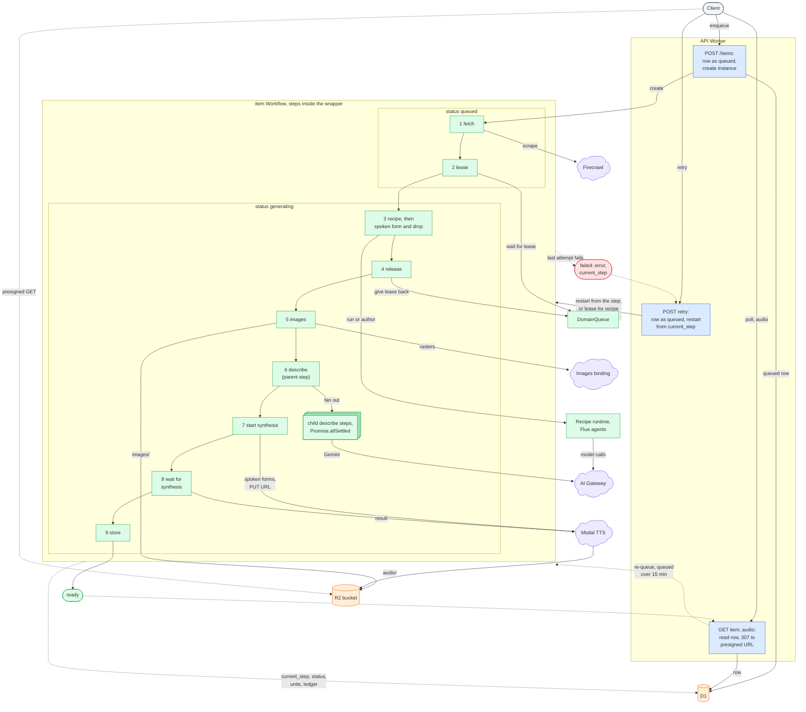
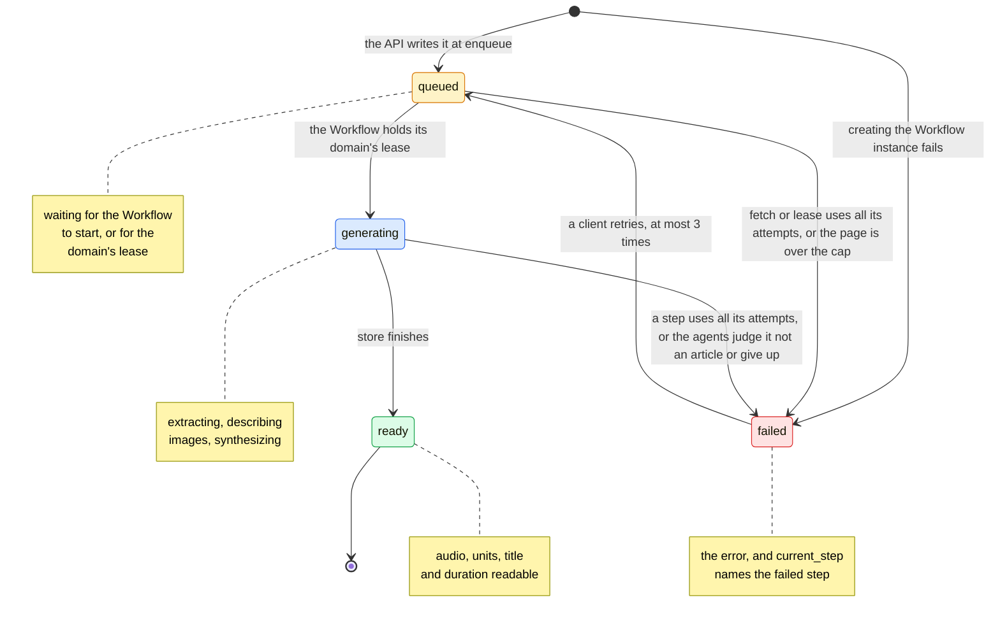
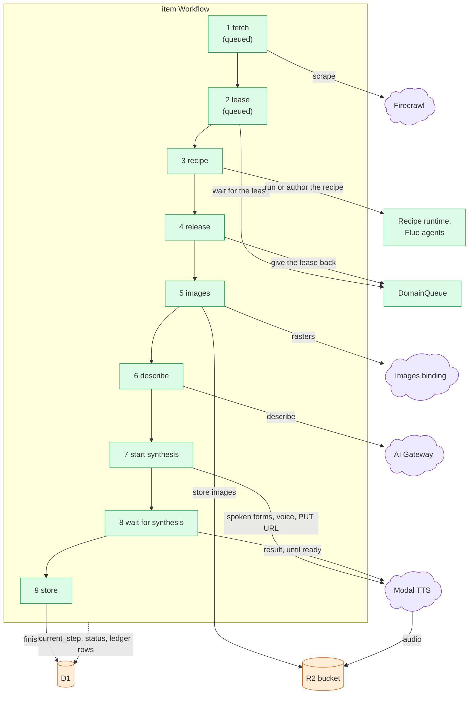
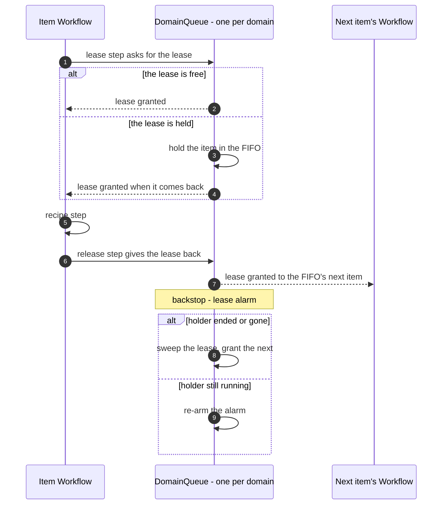

# Item lifecycle

## 🔭 Overview

An item is the record of one `enqueue(url, voice?)` call, from creation through to playable audio or a clear failure. The API Worker writes the item row as `queued` and creates the item's Workflow instance in the pipeline Worker; the item Workflow then does all the work for that item in nine steps and writes every later status into the row. The poll route reads only the row, never the Workflow instance. A retry restarts the same instance from the step that failed. [article-extraction](article-extraction.md) covers how the extracted markdown units become the item's units, [recipes](recipes.md) covers the scripts that extract them, and [read-along-timing](read-along-timing.md) covers what the TTS service hands back.

## 🗺️ How an item moves through the system

The client enqueues through the API Worker, which writes the row as `queued` and creates the item Workflow. fetch and lease run with the item `queued`; every later step runs with it `generating`, and store ends it `ready`. A step whose last attempt fails ends it `failed`, with the error and `current_step` on the row. The retry route writes `queued` and restarts the instance from `current_step`, or from lease when the failed step is recipe or release. The client polls the row through the API Worker, which re-queues an item `queued` for more than 15 minutes, and follows a 307 to read the audio from R2.

## 💽 Modeling

The item row in D1, one per `enqueue` call, with `status` one of `queued` / `generating` / `ready` / `failed`. Its TypeScript type lives in the [common/ package](common-package.md), which both Workers build from:

| Field | Answers |
|---|---|
| `id` | the item's identity: `"itm_"` plus 8 hex characters |
| `url`, `title` | which article this item is for; `title` is written by the recipe step, together with the units |
| `voice` | which Kokoro voice this item's audio uses, fixed at creation |
| `created_at` | when it was enqueued; never moves |
| `updated_at` | when the row was last written |
| `queued_at` | when the item was last queued: set at enqueue and rewritten whenever the item is queued again, by a retry or by the re-queue of a stale `queued` item |
| `workflow_instance_id` | the item's Workflow instance id, which is the item id, written by the Workflow's first step; empty until that step runs, even when the instance already exists |
| `current_step` | the name of the step the Workflow is running, written as each step starts; empty before the first step, and on a `failed` item the step that failed |
| `extraction_domain` | the final URL's domain after redirects, which picks the recipe |
| `recipe_version_id` | the recipe version the item was extracted with, or the one the agents authored or revised; see [recipes](recipes.md) |
| `retry_count` | how many times this item has been retried; bounds re-spend against the cap of 3 |
| `duration`, `audio_format` | populated once `ready` |
| `units` | the typed display/spoken/timing units: written by the recipe step, the described units' spoken forms rewritten by the describe step, and timed by the store step; the API shows them only once the item is `ready`; see [article-extraction](article-extraction.md) and [item-contract](item-contract.md) |
| `degradations` | per-unit enrichment failures that did not fail the item; null when the enrichment was clean |
| `error` | populated only when `status` is `failed` |

`units` and `degradations` are JSON columns, and common/ encodes and decodes them for both Workers. Audio bytes are never a column on this row; they live in the R2 bucket under the `audio/` prefix, keyed by item id, as described in [persistence-and-storage](persistence-and-storage.md). A step writes the units and the degradations to the row as soon as it produces them, and later steps read them from there. Only the values the Workflow needs and the row does not hold pass from one step to the next as step results: the fetched HTML, the images the recipe declared, Modal's call id and the synthesis result.

## 🟢 States

**Enqueue** writes the item row as `queued`, with `queued_at`, then creates the item's Workflow instance through the API Worker's cross-script Workflow binding, with the item's id as the instance id and as the only param, and returns `202`. The Workflow reads the URL and the voice from the row. When creating the instance fails, the API writes the item as `failed` with the error the binding returned, `current_step` stays empty, and a retry creates the instance.

**`queued`** covers the time until the Workflow starts and the time it waits for its domain's lease behind another article from the same domain. **`generating`** starts once the Workflow holds the lease and covers extraction, images, describe and synthesis. **`ready`** and **`failed`** end the Workflow, which writes either one with the rest of the finished state: the timed units and the audio's duration and format for `ready`, the error for `failed`.

**Poll** reads the row and never the Workflow instance. When the row is `queued` and its `queued_at` is more than 15 minutes old, the API queues the item again when it reads the row. It first claims the row with one conditional write. The write rewrites `queued_at` only if the row is still `queued` and `queued_at` is still more than 15 minutes old, so two polls that arrive together queue the item once. Then it restarts the item's instance from the step `current_step` names, the same restart point a retry uses. When the row holds no instance id, it creates the instance with the item's id; a create that reports the instance already exists restarts that instance from the same point instead. When the restart or the create throws, the API logs the error and the poll answers the item as it is; the claim has already moved `queued_at`, so the next poll that finds it stale 15 minutes later tries again. This re-queue also recovers an item stuck locally because the pipeline Worker was not running when the API created its instance. An item stays readable after Cloudflare drops the Workflow instance at the end of its retention window, because nothing the poll returns lives on the instance.

> [!NOTE] Why a create can turn into a restart
> The Workflow writes its instance id into the row in its first step, so a row without one may belong to an instance that exists and has not run that step yet. Keying the instance by the item id makes that instance findable, and the create's `already_exists` error is the sign to restart it.

> [!NOTE] Why a re-queue does not count toward the retry cap
> The cap bounds how often a client spends again on an item that failed. A re-queue recovers an item that never failed, waiting on a Workflow that has not moved, so counting it would let a slow start use up a client's retries.

**Retry** (`POST /items/{id}/retry`) moves a `failed` item back to `queued` and restarts its instance; the section below covers it.

> [!NOTE] Why `queued` and `generating` are separate states
> `queued` is the time an item waits behind work it does not control: the Workflow starting, or another article from the same domain holding the lease. `generating` is the time the Workflow spends on this item's own work. A client that sees `queued` for a long time knows the item is waiting its turn rather than stuck in a step.

> [!TIP] Rejected: one combined in-flight state
> Collapsing `queued` and `generating` into a single "working" status removes a column value but hides from the client whether the item is waiting for its domain's lease or doing its own work.

## 📩 The item Workflow's steps

The item Workflow lives in the pipeline Worker and does all the work for one item, in nine steps run in order. Its first step writes the instance's id into the row.

| Step | What it does | Attempt timeout |
|---|---|---|
| fetch | gets the page through Firecrawl with the Workflow's own fetch client; see [article-extraction](article-extraction.md) | 2 min |
| lease | waits for the domain's lease from DomainQueue through `waitForEvent`, asking again after each wait that times out | 5 min per wait, up to 3 waits |
| recipe | runs the domain's recipe through the recipe runtime; the Flue agents author or revise it when the domain needs one, and the Workflow writes the new recipe version; at its end the step derives each unit's spoken form, drops a unit whose spoken form has no letter or digit, and writes the title and the units to the row; see [article-extraction](article-extraction.md) | 15 min |
| release | hands the lease back to DomainQueue | 1 min |
| images | fetches, processes and stores each image of the article; see [article-extraction](article-extraction.md) | 5 min |
| describe | runs one child step per code block and flagged image concurrently, each asking Gemini through AI Gateway for a spoken sentence, then writes the results to the row; see [image-and-code-describer](image-and-code-describer.md) | 5 min; 1 min per attempt for each child step |
| start synthesis | hands Modal the spoken forms, the voice and a presigned R2 PUT URL that the pipeline Worker signs; see [tts-service](tts-service.md) | 2 min |
| wait for synthesis | asks Modal for the result every 5 seconds until it is ready | 15 min |
| store | writes the finished state into the row, with the synthesis's ledger row | 1 min |

Each step has 3 attempts, the first and two retries, and each attempt has its own timeout. A step that makes a metered call writes its ledger row. The Workflow returns no output; everything it produces is on the row.

> [!NOTE] Why the units live on the row and the HTML in a step result
> A step result is capped near 1 MiB, and the Workflow keeps it so a later step, and a restart from a later step, can read it. The fetched HTML is needed only by the recipe step, so it rides as fetch's step result. The units are read and changed by several steps, so they sit on the row, and each step that changes them writes them there.

> [!NOTE] Why waiting for synthesis is one step
> One step that asks Modal every 5 seconds inside its own body keeps one name in `current_step`, and a retry restarts it without starting a second synthesis.

> [!TIP] Rejected: a loop of polling steps
> The Workflow replays a step's stored result by the step's name, so each round of a polling loop needs a step name of its own, and `current_step` would carry a round number instead of the step's name.

> [!WARNING] A step can run twice
> A deploy can interrupt a step mid-attempt, and the Workflow runs it again. Modal accepts no idempotency key, so a start synthesis that runs again synthesizes a second time; the second upload overwrites the same audio key, because the key is the item id. The duplicate costs one synthesis and is accepted.

### 🎁 The step wrapper

Every step runs inside one wrapper holding the logic common to all of them. At the start of each attempt, inside the step, the wrapper writes `current_step` and the status the step is given, and clears the error, so a restart from that step writes them again. fetch and lease are given `queued`; every later step is given `generating`, so the item shows `generating` from the moment the lease is held. When a step's last attempt fails, the wrapper writes `failed` and the step's own error. A not-article verdict or the agents giving up fails the recipe step at once, without its remaining attempts, and a fetched page over the step result cap fails the fetch step the same way. An attempt that fails while attempts remain writes nothing, so a step's automatic retries never show `failed`.

The status write sets the status and `current_step` and stamps `updated_at` in one statement. It has two forms: `queued` or `generating` takes no error and clears it, and `failed` requires the error, so the type checker rejects a `failed` write without one. The status write belongs to the [common/ package](common-package.md). The API uses the same write for `queued` at enqueue and on retry, and for `failed` when it cannot create the instance.

### 🗣️ The describe fan-out

describe is one step, inside the wrapper like every other. Inside it, one child step per description runs concurrently, and the parent awaits them all with `Promise.allSettled`. Each child calls Gemini and returns its result without writing to the row; like every step it has 3 attempts, each with a 1-minute timeout. The parent collects the results and writes every described unit's spoken form, the degradations and the ledger rows in one write at its end.

A Workers instance holds 6 outbound connections, across all its steps, so at most 6 Gemini calls run at a time while the rest wait, and the wait counts toward the steps' timeouts. In the parallel-steps spike, 25 concurrent 5-second fetches finished in batches of 6, the last after 26 s.

The parent never fails because a child failed. A child that uses all its attempts leaves its unit on the fallback and records a degradation, even when every description fails, and the Workflow continues to start synthesis.

> [!NOTE] Why one parent step writes once
> A single write at the parent's end leaves no concurrent writes to the `units` column to reconcile, and the wrapper handles describe as it handles every other step. The cost is in retries: a retry of the parent gives every child a new step identity and runs all of them again, so a repeated describe goes back to Gemini, where AI Gateway's response cache can answer it.

## 🚦 One extraction per domain: DomainQueue

DomainQueue is a Durable Object in the pipeline Worker, one instance per domain key, holding a lease and a FIFO queue in its storage. It lets one item per domain extract at a time. The lease step asks the domain's DomainQueue for the lease and waits for the grant through `waitForEvent`; DomainQueue grants the lease at once when it is free, or holds the item in its FIFO and grants it when the lease comes back. The release step returns the lease right after recipe, so the lease blocks only extraction, and DomainQueue grants it to the next item in the FIFO.

The release step is the fast path; the alarm is the backstop for an item whose Workflow never runs it. Acquiring the lease sets an alarm one minute out; when it fires on a busy domain, DomainQueue asks the platform for the holding instance's status. When the status is ended or the instance is unaddressable, DomainQueue sweeps the lease and grants it to the next item; when the instance is running, DomainQueue re-arms the alarm. A step that fails for good while the item holds the lease leaves the instance errored, so the alarm releases the lease. DomainQueue grants the lease to an instance id that asks for it again, so a retry that restarts from the lease step gets the lease even while DomainQueue still records the earlier attempt as holding it. An instance id that asks again while it waits in the FIFO keeps its place, so a re-queue of an item waiting for the lease does not send it to the back.

## 🧩 The recipe runtime

The recipe step runs the domain's recipe through the recipe runtime, and the Flue agents' one tool runs the same runtime:

| Member | Answers | Who asks |
|---|---|---|
| `run(recipe source, html)` | the title and the units, or the validation report | the recipe step, and the agents' one tool |
| `validate(extraction, html)` | the mechanical checks' report alone, over the recipe's units, container, inventory and ignores | `run`, on every execution |

`run` executes the script inside a Dynamic Worker: the injection bundle carries cheerio, domino, turndown and its GFM plugin (`@truto/turndown-plugin-gfm`) with it, the article parses inside because the recipe's `$` must exist there, and what returns is JSON. The script's `toMarkdown` calls serialize each selected element with its own tag, so Turndown sees the tag that selects its markdown rule. `toMarkdown` also wraps a `<pre>` with no `<code>` child in `<code>` before conversion. The validator is not part of the bundle; the mechanical checks run in the main Worker, so one implementation serves the recipe step and the agent tool path. Once the script returns its declared units, each tied to its real element path, the host validator checks them. When they pass, `run` returns the title and the units (see [markdown-units](markdown-units.md)). A recipe that does not parse, throws against changed markup, or hangs until the CPU cap kills it, is a validation failure: the revision path's trigger, with its crash report as the validator report. A module that does not parse never starts the Dynamic Worker, so it cannot report itself as data; the load failure is recognised from the platform's own error, which names `recipe.js` in some runtimes and raises a bare `SyntaxError` in others. Only platform failures outside the recipe fail the step: a Dynamic Worker that is unreachable, a bundle that does not load.

> [!WARNING] Recipe source executes in a Dynamic Worker
> workerd blocks every direct path to running source: `eval` and `new Function` throw, `data:` URL imports do not resolve. A Dynamic Worker, in open beta for runtime-given code, runs the script instead, and the beta is the standing risk. The local half of the proof holds: `pipeline/test/dynamic-workers-proof.test.ts` runs real recipe source through the Worker Loader under vitest on workerd and gets the same extraction from two consecutive runs. The edge half stays open. miniflare's Worker Loader does not enforce `limits.cpuMs`, so the kill that turns a spinning recipe into a validation failure is observable only against the real platform, and that case is skipped in the suite and run by hand. The deterministic stack around it is proven on workerd: cheerio parses a real article in 8 to 18 ms, and the fixed pass converts in 2 to 19 ms with turndown over domino-parsed nodes.

## 🤖 The Flue author and revision agents

The recipe step dispatches the author agent when the domain has no recipe and the revision agent when the recipe fails validation. The conversation is keyed by the item's Workflow instance id alone, so a recipe step's own retries and a restart from the recipe step continue the same conversation. It carries no history from other items, and its prompts are self-contained. The bounds are one hundred turns, authoring one retry, revision two, set in configuration with the model; the model is flash-class, to be chosen by evaluation before the agent round runs, and its calls go through AI Gateway. The settled reply is a script validated in-loop by its own tool calls, a not-article verdict from the author, or the agent giving up. The reply never carries units. The recipe step runs every settled script through the runtime, so a fresh recipe and a years-old one extract through the same deterministic path (invariant 10).

## 🔁 Retry restarts from the step that failed

`POST /items/{id}/retry` re-drives a `failed` item. The route writes `queued`, rewrites `queued_at` and clears the error. Through the same Workflow binding enqueue uses, it restarts the item's instance from the step named in `current_step`, or creates it when the row holds no instance id, the same way a re-queue does (see States). It returns `202`. The steps that succeeded do not run again: the restarted step reads their step results and the units already on the row. A failed recipe or release step restarts from the lease step instead, so the item asks for its domain's lease again and the recipe step re-reads the domain's current recipe. The Workflow then moves the item to `generating` as on its first run. [item-contract](item-contract.md) carries the route and wire detail.

**Only a `failed` item under the cap is retryable.** `queued`, `generating` and `ready` all return `409`, and so does a `failed` item at or past 3 retries.

When the restart or the create throws after the claim, the route writes the item back to `failed` with that error and the same `current_step`, and answers `202` with the failed item. The retry stays counted toward the cap.

> [!NOTE] The claim that stops two concurrent retries
> The `failed → queued` move is one conditional write gating on status still `failed` and `retry_count` under the cap, incrementing the count in the same statement. Two concurrent retries cannot both win: only the first finds the preconditions met, the second changes no row and the route refuses it with `409`. A read-then-write would let both pass and restart the instance twice, and would increment the count once, so the cap would read tighter than it is.

The API never calls Cloudflare's REST API to find where the Workflow stopped: `current_step` on the row names the step, and the wrapper writes it as each step starts. In the restart spike the restarted step started about 3.5 s after the restart was accepted.

An item stuck in `queued`, including one stuck in local development because the pipeline Worker was not running, needs no retry: the API re-queues it once its `queued_at` is more than 15 minutes old, as described under States; see [local-development](local-development.md).

> [!NOTE] Retry does not re-fetch once extraction resolved
> Re-fetching would not reliably reproduce the first extraction: firecrawl's output is non-deterministic, measured at a 5x spread on the same URL minutes apart. So a retry resumes from the step that failed and reuses the earlier steps' results rather than re-deriving them, which means it cannot repair an item whose extraction was wrong. A force-restart that re-fetches such an item is a separate, deliberate design problem, not something half-built here.

## 🏷️ What a failure names

Every `failed` item carries the failed step's own error, with no phase prefix, and its `current_step` names the step that failed, so a reader can place a failure without a stack trace; `current_step` is empty only when the instance was never created. An item fails when a step uses all 3 of its attempts, and in these cases:

- **Not an article**: the author agent judges the page is not an article, and the recipe step fails the item without retrying.
- **The agents give up**: the author or revision agent settles without a passing script, and the recipe step fails the item without retrying, so the agents' own retry bound is the only one that applies.
- **HTML over the cap**: the fetch step's result, the page's HTML and its domain serialized as JSON, is over the 1 MiB a step result can carry; the fetch step fails the item without retrying.
- **Synthesis that fails every time**: the wait for synthesis step uses its attempts on a crashed synthesis and fails the item.
- **Result expired**: Modal holds a synthesis result for 7 days; the wait for synthesis step then fails the item without retrying.
- **Instance not created**: creating the Workflow instance at enqueue fails; the API writes the item as `failed` with that error.
- **Storage failure on finalize**: synthesis completes, but writing the finished state fails; the store step fails the item rather than leaving it stuck `generating`.

No time limit bounds a whole item. An item that waits for its domain's lease through 3 waits of 5 minutes each fails like any step out of attempts. An item stuck in `queued` does not fail: the API re-queues it when it reads the item and finds `queued_at` more than 15 minutes old.

> [!NOTE] A per-unit degradation is not a failure
> Enrichment distinguishes a systemic failure from a single unit that could not be acquired or described. A failed image fetch or a failed describe call for one unit is recorded in `degradations` and the item still reaches `ready`; a failed describe child never fails the describe step, and only an exception that stops a whole step fails the item. So `degradations` is populated on items that succeeded, and `error` only on items that did not.

> [!WARNING] Extraction can succeed on the wrong thing
> A URL serving a 200-status error page (a GitHub Pages 404, say) extracts cleanly, generates audio, and reaches `ready`: the worst failure mode, because it looks like a working item and the status is never `failed`. Separating a real article from a plausible 200-status error page is unsolved.

## ⚙️ Platform limits

A Workflow instance has no wall-clock limit; the bound is CPU per invocation, tens of seconds by default and configurable upward. The agent loops never approach that bound, because model turns are input-output waits. Step results are each capped near 1 MiB as serialized, which bounds the fetched HTML together with its domain and the JSON escaping; an item's units, a few hundred kilobytes for a long article, fit well inside. Instance state persists for the retention window, days on the free tier and a month on the paid tier; the poll reads only the row, so an item outlives its instance.

## ⏩ What is not built yet

Quota enforcement and a `GET /items` list endpoint are deferred and not part of this lifecycle; see [item-contract](item-contract.md)'s "what is not built yet".

## ℹ️ Sources

- Cloudflare Workflows, Workers API and limits: https://developers.cloudflare.com/workflows/build/workers-api/ and https://developers.cloudflare.com/workflows/reference/limits/
- Triggering workflows, including from a Durable Object: https://developers.cloudflare.com/workflows/build/trigger-workflows/
- Flue on Cloudflare, agents as Durable Objects: https://flueframework.com/docs/ecosystem/deploy/cloudflare/
- Flue workflows, dispatch and read from a step: https://flueframework.com/docs/guide/workflows/
- Dynamic Workers, the open-beta primitive for runtime-given code: https://developers.cloudflare.com/dynamic-workers/

---

Related: [article-extraction](article-extraction.md) · [recipes](recipes.md) · [markdown-units](markdown-units.md) · [image-and-code-describer](image-and-code-describer.md) · [tts-service](tts-service.md) · [item-contract](item-contract.md) · [persistence-and-storage](persistence-and-storage.md) · [common-package](common-package.md) · [local-development](local-development.md) · [authentication](authentication.md) · [invariants](invariants.md)
