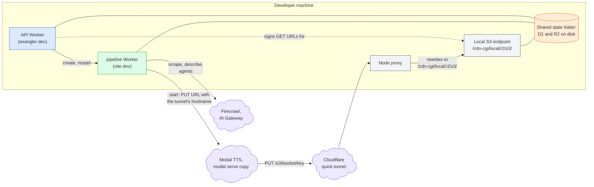

# Local development

## 🔭 Overview

Locally, the pipeline Worker runs under vite dev and the API Worker under its own wrangler dev, and both keep their state in one shared folder, so they see the same D1 database and the same R2 bucket on disk. The Workers call the real Firecrawl and the real AI Gateway for Gemini and the Flue agents, and an ephemeral copy of the TTS app that `modal serve` runs on Modal. Modal uploads the audio into the local bucket through a Cloudflare quick tunnel and a small local Node proxy.

## 🚀 How to run both Workers locally

Each Worker's `.dev.vars.example` names the secrets and local values its `.dev.vars` needs.

1. Apply common/'s migrations to the shared state folder: `pnpm migrate:local` in `common/`.
2. Start the Node proxy: `pnpm dev:proxy` in `pipeline/`. It listens on port 8792.
3. Start a quick tunnel to the proxy with `cloudflared tunnel --no-autoupdate --url http://localhost:8792`, and write `R2_UPLOAD_ENDPOINT=https://<hostname>/s3` into `pipeline/.dev.vars`, with the tunnel's hostname in place of `<hostname>`.
4. Start the pipeline Worker: `pnpm dev` in `pipeline/`, on port 5173. It reads the tunnel's hostname from `.dev.vars` when it starts, so it starts after the tunnel.
5. Start the API Worker: `pnpm dev` in `api/`, on port 8788.
6. Serve the TTS app: `uv run modal serve app.py` in `tts/`. The pipeline Worker's `.dev.vars` points its two endpoint URLs at this copy.

## 🏗️ Architecture

The API Worker creates and restarts the item Workflow through the same cross-script Workflow binding it uses in production; the two dev servers find each other locally. Both Workers point at the same state folder, so D1, R2 and the Durable Objects are one set of files on disk. Locally, D1's schema comes from common/'s migrations, applied with wrangler against that folder (see [the common/ package](common-package.md)).

> [!WARNING] A Worker that does not share the state folder sees an empty database
> Each dev server keeps its state under its own config directory unless it is pointed at the shared folder. A Worker started without it finds no tables and an empty bucket.

## 📤 How Modal's audio reaches the local bucket

Modal runs in the cloud and uploads the audio to a presigned PUT URL, as in production. Locally that URL points at wrangler's experimental local S3 endpoint, which the pipeline Worker's dev server serves at /cdn-cgi/local/r2/s3/ and which checks the URL's signature.

1. The pipeline Worker signs the PUT URL for localhost with the same presigning function it uses against R2 in production (see [the common/ package](common-package.md)).
2. It hands that URL to Modal with localhost's endpoint replaced by the one in `R2_UPLOAD_ENDPOINT`. The URL then holds the quick tunnel's hostname and the path /s3/<bucket>/<key>. In production both endpoints are R2's, so the same code runs in both places.
3. Modal PUTs the audio to the tunnel, which forwards it to the Node proxy.
4. The proxy maps /s3/<bucket>/<key> to /cdn-cgi/local/r2/s3/<bucket>/<key> with localhost as the host, so the signature matches, and the local endpoint writes the object into the shared state folder.

The API Worker has no bucket binding. It signs the GET URLs its audio and image routes redirect to for the same local S3 endpoint, so a client following a `307` reads the shared local bucket, and the links work only while the pipeline Worker's dev server runs.

The local S3 endpoint checks every presigned URL against a pair of dummy credentials. The pipeline Worker's vite configuration gives them to the local bucket only when it serves, so the deployed configuration carries none, and both Workers' local R2 keys in `.dev.vars` are those same dummy values. They protect nothing and are not secret.

> [!NOTE] Why a proxy sits behind the tunnel
> Cloudflare's edge answers every /cdn-cgi/ path on trycloudflare.com itself, so a request for /cdn-cgi/local/r2/s3/ never reaches the dev server. The proxy gives the tunnel a path outside /cdn-cgi/ and restores the endpoint's path and host locally.

> [!WARNING] The tunnel's hostname can change on every start
> A quick tunnel gets a new random hostname each time it starts. The pipeline Worker reads the hostname from its configuration, so the configuration has to name the tunnel that is running; an upload to an old hostname never reaches the local bucket.

## 🔁 Re-queuing a stuck item

An item enqueued while the pipeline Worker is not running cannot start. When the API fails to create its Workflow instance, the item fails at enqueue, and a retry once the pipeline Worker is running creates the instance. When the API creates the instance while the pipeline Worker is not running, the instance errors at once with `Worker "nagara" not found`, the API sees no error, and the item stays queued. The API re-queues the item the way it re-queues any item queued for more than 15 minutes. When the API reads the item, it rewrites queued_at and replaces the errored instance with a new one under the item id with a suffix, `<item id>-2` (see [item-lifecycle](item-lifecycle.md)). The developer polls the item once the pipeline Worker is running, and the item starts again.

> [!WARNING] A dev-server reload strands the running Workflow instance
> An edit reloads the dev server, and a Workflow instance that is running during the reload never resumes: its item stays in the status it had. An item stranded in queued is re-queued once its queued_at is more than 15 minutes old.

---

Related: [the common/ package](common-package.md) · [item-lifecycle](item-lifecycle.md) · [tts-service](tts-service.md) · [persistence-and-storage](persistence-and-storage.md) · [deployment-and-ci](deployment-and-ci.md)
