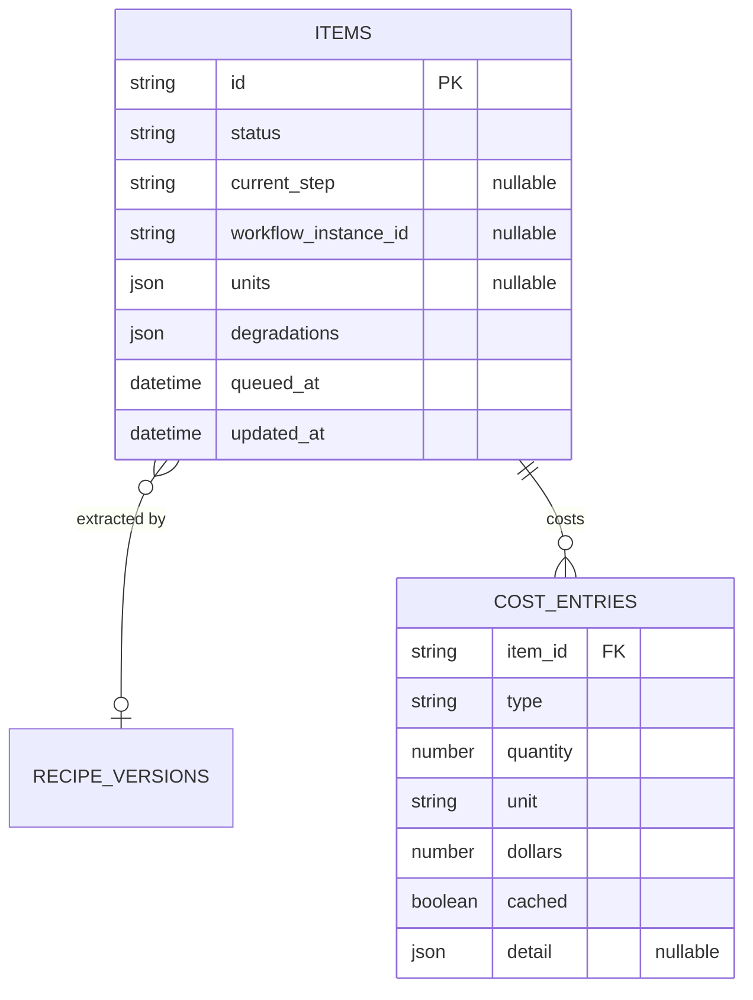
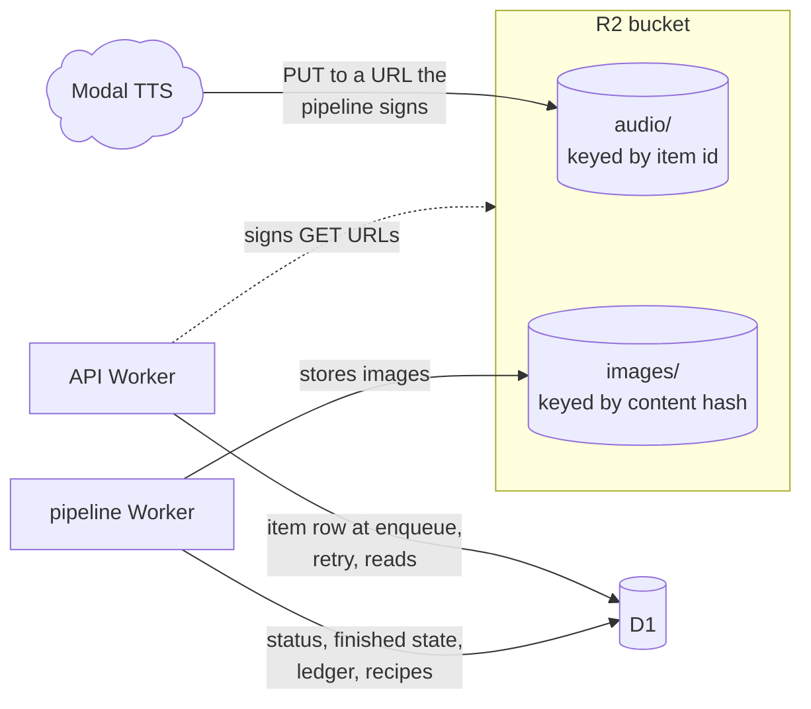
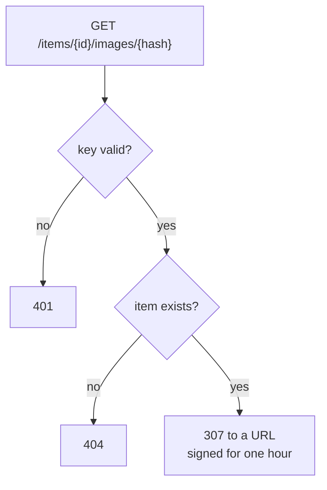

# Persistence and storage

## 🔭 Overview

What the item row persists, where its audio and images live, and the ledger that records what each item cost. One D1 database holds every row and one R2 bucket holds every object; both Workers bind the database, and only the pipeline Worker binds the bucket. Both Workers build the row's shape, the R2 key layout and the URL presigning from [the common/ package](common-package.md), so the two Workers agree on every column and every key.

## 💽 Modeling

The database has three tables: `items`, one row per enqueued article; `recipe_versions`, one row per version of a domain's recipe; and `cost_entries`, one row per metered call. The item row's full field list is in [item-lifecycle](item-lifecycle.md); the diagram shows the fields this note is about. Audio bytes are never a column; they live in the bucket below, keyed by item id, so a multi-megabyte file never bloats the row.

The row always holds the item's status. The API Worker writes `queued` at enqueue, or `failed` with the error when it cannot create the instance; the item Workflow's step wrapper writes every later status together with `current_step` as each step starts. The Workflow writes the finished state when it ends, and a failed item's `error` is the failing step's own error, with `current_step` naming that step. `workflow_instance_id` names the item's Workflow instance, which the retry route restarts; `updated_at` records the last write. `queued_at` is set at enqueue and rewritten whenever the item is queued again: when the API reads a `queued` item whose `queued_at` is more than 15 minutes old, it restarts the item's instance, or creates one when the row holds no instance id, and rewrites `queued_at`. The poll reads only the row and never the instance, so an item stays readable after Cloudflare drops the instance at the end of its retention window. Both writers go through the status write in [common/](common-package.md), which sets a status and stamps `updated_at`, clearing the error for `queued` and `generating` and requiring one for `failed`.

The Workflow writes `units` and `degradations` into the row as soon as a step produces them, and later steps read them back from the row. The recipe step writes the title together with the units, which carry their display and spoken forms; the images step rewrites them, and the describe step writes every described unit's spoken form, with its degradations and ledger rows, in one write at its end. Its child steps, one per description and run concurrently, only return their results to it. The API returns the units to a client only once the item is `ready`.

> [!NOTE] Why the describe children write nothing to the row
> Up to 25 children run at once. A child that read the list, changed its unit and wrote the whole list back would overwrite the results its siblings wrote in between, so the parent collects every result and makes the one write.

`units` is the one list the whole pipeline rides on. Each element is a typed unit carrying its display markdown, its spoken form, and its timing window, and that single list serves display, synthesis, and read-along alike (see [item-contract](item-contract.md) for the unit shape and the wire projection that drops `spoken`). Because there is one list rather than two parallel lists, a dropped unit takes its timing window with it instead of leaving one list longer than the other; [invariants](invariants.md) carries why that matters.

`units` and `degradations` are JSON text columns. The row's TypeScript type and the functions that encode and decode its JSON columns live in [common/](common-package.md); the types are checked when each Worker builds, and a value read back from D1 is trusted to match its type.

A long article's units come to a few hundred kilobytes (about 150 to 250 KB for a 70-minute article), far below D1's 10 MB limit for one value.

`degradations` is a JSON list of typed objects the client never sees, written by the images and describe steps as each one records a loss. Each object carries a `type` and a short `reason`, and an acquisition failure also carries the origin `url`, the locator worth re-fetching once the unit is gone. `type` is the unit discriminator, so in practice only `image` and `code` appear: a paragraph cannot enrich, so it cannot degrade. The `reason` says both what happened and what nagara did about it:

| `reason` | What happened |
|---|---|
| `404`, `timeout`, `undecodable` | acquisition failed, so the unit was dropped from the list |
| `describe failed`, `describe cap reached` | the unit stays, but its spoken form fell back to alt text or the honest floor |

> [!NOTE] Why a separate column and not `error`
> `error` is failed-only by design, and that rule is worth keeping. So it cannot describe an item that reached `ready` after dropping six of twelve images: technically `ready`, quietly worse. `degradations` gives the operator a full record of what was lost while the client, reading only the wire fields, sees an item that looks whole.

The schema also has a `recipe_versions` table: one row per version of a domain's recipe, and an item points at the version that extracted it through `recipe_version_id`. The row's shape and why a revision is a pure insert are in [recipes](recipes.md).

> [!TIP] Rejected: audio as a database blob, or proxied through the API
> Storing audio bytes in the database bloats the row store with multi-megabyte blobs; proxying them through the API routes large downloads through the Worker, and a headerless `<audio>` element cannot follow a credential-guarded byte stream anyway. A separate store reached through a signed link avoids both.

## 🗃️ How the schema changes

The schema is a set of hand-written SQL migrations in [common/](common-package.md). The Cloudflare CI workflow's migrate job applies them to D1 with wrangler before the pipeline Worker and the API Worker deploy, in the same workflow, so neither Worker ever runs against a schema older than its code (see [deployment-and-ci](deployment-and-ci.md)). Deploys are not made twice in quick succession, so two migration runs never overlap. Locally, the developer applies the same migrations with wrangler to the D1 database in the shared state folder (see [local-development](local-development.md)), and the Workers' tests build their D1 schema by applying them too.

## 🏗️ Architecture

Both Workers bind the same D1 database. Only the pipeline Worker binds the R2 bucket, and it writes images into the bucket directly through that binding. Modal writes the audio from outside Cloudflare, so it uploads to a presigned PUT URL the pipeline Worker signs with an R2 API token of its own. The API Worker has no bucket binding: it signs GET URLs for clients with a separate R2 API token's S3 key pair against the bucket's S3 endpoint. The key layout and the presigning function both come from [common/](common-package.md):

| Piece | Answers |
|---|---|
| audio prefix and key function | the object key for an item's audio, built from the item id alone |
| images prefix and key function | the object key for an image, built from its content hash alone |
| presigning | a GET or PUT URL for one key, signed with the R2 token and lifetime the caller passes |

> [!NOTE] Why the API Worker binds no bucket
> Signing a URL needs only the key pair and the endpoint, and the API never reads or writes an object's bytes: a client follows the `307` to the bucket itself.

> [!NOTE] Why audio is keyed by the item id
> Two items never share an audio file, even for the same article and voice. Modal accepts no idempotency key, so a start step that runs twice after a deploy synthesizes twice; both uploads land on the same key and the second overwrites the first.

> [!NOTE] Why a content hash keys an image, not the item id or the origin URL
> Hashing the stored bytes dedupes for free: across items, across re-enqueues of the same article, and across a repeat of the same image within one article, which happens whenever `og:image` is echoed in the body. The format is verified by decoding through the Images binding rather than trusting `Content-Type` (wrong or missing on most image CDNs), and the WebP re-encode collapses source-format variants of one raster to a single stored object. An SVG is stored as SVG with its scripts stripped, and its content type is stored on the object, so the key carries no extension.

Locally, `wrangler dev` and `vite dev` back the bindings with a D1 database and an R2 bucket on disk in one shared state folder, the API Worker signs its GET URLs for the local S3 endpoint the pipeline Worker's dev server serves, and Modal reaches the local bucket through a tunnel; [local-development](local-development.md) carries how.

> [!NOTE] Why configuration and not an environment name
> "Which backend" is expressed as configuration a deployment supplies (the bindings, the R2 endpoint a URL is signed for, a set of credentials), never as an `if production` or `if testing` branch in runtime code. The same code path runs everywhere; only the supplied configuration differs, so there is no production-only path the test suite never exercises because a flag hid it.

## 🔗 Serving audio and an image

Both media routes mint the response at request time and persist nothing. Each returns a 307 to a GET URL the API Worker signs for one hour, in every environment. `GET /items/{id}/audio` serves the one audio file; `GET /items/{id}/images/{hash}` serves one image by its content hash. The bucket serves that image by its hash alone, since the hash is deduped across items; the route confirms the item exists and leaves the hash-to-item association to [item-contract](item-contract.md). Both routes require the key, so the auth invariant holds on every route that touches an item.

> [!NOTE] Why a presigned URL is never written into the row
> The unit list is persisted indefinitely, and a presigned URL is dead an hour after it is signed. So a unit stores the content hash and its display markdown embeds the route path; the signed URL is minted only when the route is called. Writing it into the row would persist a link that expires an hour later.

## 🧾 The cost ledger

Every metered call writes one row to `cost_entries`, scoped to its `item_id`. The ledger records spend and enforces nothing: a budget or a rate cap is a separate concern.

| Column | Holds |
|---|---|
| `type` | the event kind: `firecrawl` / `describer` / `tts` |
| `quantity` + `unit` | the raw measure: `credits`, `calls`, or `seconds` |
| `dollars` | the cost, snapshotted from configured prices at write time |
| `cached` | true when AI Gateway's response cache answered the call, false otherwise |
| `detail` | nullable JSON: firecrawl destination and proxy, describer kind (`code`/`image`), tts duration |

`type` and `unit` are constant maps in [common/](common-package.md) with their types derived from them, per the project's no-enum rule. Prices are configuration per invariant 6, each a plan- or vendor-dependent estimate. The Flue agents' model calls write no ledger row.

> [!NOTE] Why both the raw measure and the dollars
> The raw measure never goes stale and re-prices against future rates; the dollar snapshot gives an instant total without joining a price table. Keeping only one loses one of those, so each row carries both.

Each item Workflow step that makes a metered call writes its own ledger row:

| Event | Measured from | Written by |
|---|---|---|
| `firecrawl` | `creditsUsed` off the scrape response | the fetch step |
| `describer` | one row per successful call, tagged by kind | the describe step, one row per child's call |
| `tts` | the synthesized audio duration | the store step |

A describe answered from AI Gateway's cache writes a row at the same flat price as one that reached Gemini, with `cached` set; the flag tells the two apart.

> [!NOTE] Why each metered call writes its own row
> A firecrawl scrape and a describer call are billed the moment they return, whether or not the item goes on to reach `ready`. So each step records its metered fact as it happens rather than waiting for the finished state, and a scrape is recorded even when the page turns out not to be an article.

## ⏩ What is not built yet

Audio caching by `(url, voice)`: identical audio is regenerated today rather than reused.

---

Related: [item-lifecycle](item-lifecycle.md) · [item-contract](item-contract.md) · [common-package](common-package.md) · [local-development](local-development.md) · [recipes](recipes.md) · [deployment-and-ci](deployment-and-ci.md) · [invariants](invariants.md)
