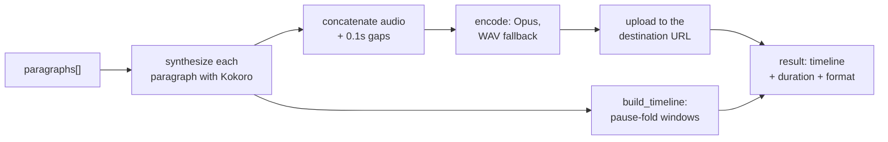
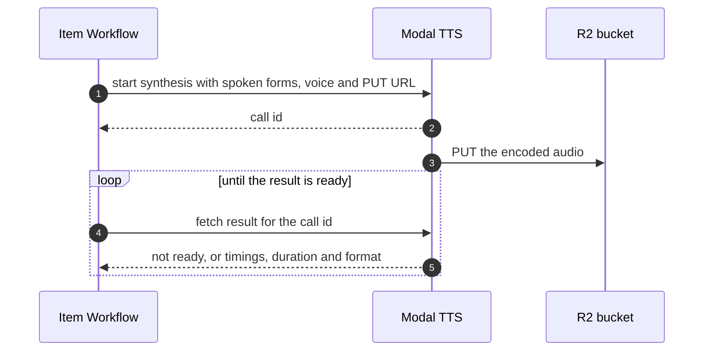

# TTS service

## 🔭 Overview

Renders an item's spoken paragraphs to audio on a GPU host, uploads the audio to the R2 bucket and produces their read-along timing. Lives at `tts/app.py`, deployed as its own Modal app (`nagara-tts`), and is invoked by the item Workflow over HTTP rather than imported. Production and local development call the same Modal app.

> [!NOTE] The TTS code is an image definition, not a callable library
> The synthesis code *is* the specification of the container image that runs on the GPU host: it declares its own base image, system packages, and model bake step, and is uploaded as a unit. It cannot execute inside a Worker; the item Workflow can only invoke it as a separately deployed service.

## ♠️ What it exposes

Two web endpoints, both behind Modal's proxy auth, so every request carries the proxy auth headers:

| Endpoint | Takes | Answers |
|---|---|---|
| start synthesis | the spoken forms, one string per read-along unit in unit order; the Kokoro voice, defaulting to `af_heart`; the destination URL, a presigned R2 PUT URL for the item's audio key | Modal's call id for this synthesis, at once |
| fetch result | the call id | `202` while the synthesis runs; `200` with the result below once it is done; `500` when the synthesis raised; `410` once Modal no longer holds the result; `422` for an id Modal never issued or one that is not a call id |

| Result field | Answers |
|---|---|
| format | which codec the audio is: `audio/ogg`, or `audio/wav` on the ffmpeg fallback |
| duration | the total audio length in seconds, what a progress bar divides by |
| timings | one `{start, end}` window per unit, in seconds, the last `end` equal to the duration; see [read-along-timing](read-along-timing.md) |

The result carries no audio bytes, because the audio is already in the bucket under the item's audio key. The pipeline Worker declares the result's shape as a TypeScript type and trusts Modal's reply to match it; nothing checks it at runtime (see [common-package](common-package.md) for the rule the shared types follow).

> [!NOTE] Why Modal uploads the audio instead of returning it
> A Workflow step can return about 1 MiB, and a full article's audio is far larger. Handing Modal a presigned PUT URL keeps the audio out of the result, so the result endpoint answers with timing and metadata alone. The pipeline Worker signs the URL with an R2 API token of its own, using common/'s presigning function and its audio key function (see [common-package](common-package.md)).

> [!NOTE] Why proxy auth
> Modal's proxy auth rejects a request at Modal's edge, before any container starts. A shared key the app checks itself works too, but the web container has to start before it can reject the request. The pipeline Worker holds the proxy auth token as a secret.

## 📩 Flow

Each paragraph is synthesized independently through Kokoro-82M and its duration recorded, then the audios are concatenated with a fixed 0.1-second silence gap between them: none after the last paragraph, since there is nothing left to separate it from. [read-along-timing](read-along-timing.md)'s `build_timeline` turns those per-paragraph durations into contiguous windows over the same concatenated audio. The encoded audio is uploaded to the destination URL, and the result Modal keeps for the call carries the timeline and the duration; the item Workflow joins the timeline onto the display markdown, described in [article-extraction](article-extraction.md), and never reads text back from the result.

> [!NOTE] A newline inside one paragraph string is Kokoro's own split, not this service's
> Kokoro splits a paragraph string at each newline before synthesizing it and joins those pieces back with no gap between them; the 0.1-second silence only sits between two separate entries of the `paragraphs` list. So a unit whose spoken form carries several lines, such as a list's items or a table's rows (see [article-extraction](article-extraction.md)), plays as one continuous paragraph audio with no silence added between its lines. The contract does not change. `paragraphs` stays `list[str]`, one string per unit, whether that string carries one line or several.

Audio is encoded to Opus through a `soundfile`-then-`ffmpeg` pipeline; if that codec path fails, it falls back to plain WAV. "Playable audio" is the only property either path is judged on, and WAV runs roughly 18 times larger than the equivalent Opus for a full article.

GPU and memory snapshotting are both enabled on the deployed class, bringing cold start down from roughly 27 seconds to roughly 6; a container then stays warm for 300 seconds after its last call, to absorb a session's burst of pushes.

## 📡 How the item Workflow invokes it with no broker

The item Workflow's start synthesis step signs the PUT URL and calls the start endpoint, which spawns the synthesis and answers with Modal's call id at once (1, 2). Modal uploads the audio to the bucket when the synthesis finishes (3). The wait for synthesis step asks the result endpoint for the call id every 5 seconds until the result is ready (4, 5). The store step then writes the finished state into the item row together with the tts ledger row, priced by the audio's length (see [item-lifecycle](item-lifecycle.md) and [persistence-and-storage](persistence-and-storage.md)). The call id and the result pass from step to step as step results; the item row holds neither. Each step gets 3 attempts. Start synthesis has 2 minutes per attempt, and wait for synthesis has 15 minutes.

A synthesis that fails every time fails the item once the wait for synthesis step has used its attempts. Modal discards a result 7 days after the call. After that the result endpoint answers `410`, and the item fails at once; a `422` for a call id Modal does not recognise fails it at once too.

> [!WARNING] A start repeated after a deploy synthesizes twice
> Modal accepts no idempotency key and no caller-chosen call id, so a start synthesis step that runs again after a deploy spawns a second synthesis. Both upload to the same audio key, keyed by the item id, so the second upload overwrites the first and the item still has one audio file. The cost is one extra synthesis, which is accepted.

> [!NOTE] Why the compute platform is the async layer, and there is no broker
> The platform's own invocation primitives (spawn plus a non-blocking result read, exposed as the two endpoints) are sufficient async infrastructure at this scale: the running-versus-crashed distinction comes for free from the result read, not from anything the item Workflow tracks separately. The two deployables also ship independently: the TTS service ships on its own deploy cadence (see [deployment-and-ci](deployment-and-ci.md)), decoupled from the Workers.

> [!TIP] Rejected: a broker and a worker process
> A conventional task-queue stack, a message broker plus a separate worker, would add infrastructure to run, scale, and monitor for no benefit the platform's own spawn/poll primitives do not already provide, and it would still need the same crash/running bookkeeping the result read gives for free.

> [!NOTE] Clients poll; nothing pushes completion
> A client observes `generating` until the item Workflow writes `ready` or `failed` into the item row, and its next poll reads it. There is no notification path; see [item-lifecycle](item-lifecycle.md) for the state machine this participates in.

The execution layer is coupled to Modal as a result: moving off it means replacing both the compute host and the async layer, and the GPU with them.

In local development Modal still runs in the cloud and uploads into the local bucket through a Cloudflare quick tunnel; [local-development](local-development.md) explains how the PUT URL reaches it.

## ⏩ What is not built yet

Streaming paragraph audio from one warm container, so time-to-first-audio is roughly one to two seconds instead of waiting for the whole article. Word-level timestamps exist inside Kokoro but are not returned or used; a caption export would be the consumer that asks for them.

---

Related: [item-lifecycle](item-lifecycle.md) · [read-along-timing](read-along-timing.md) · [item-contract](item-contract.md) · [persistence-and-storage](persistence-and-storage.md) · [common-package](common-package.md) · [local-development](local-development.md) · [deployment-and-ci](deployment-and-ci.md) · [invariants](invariants.md)
